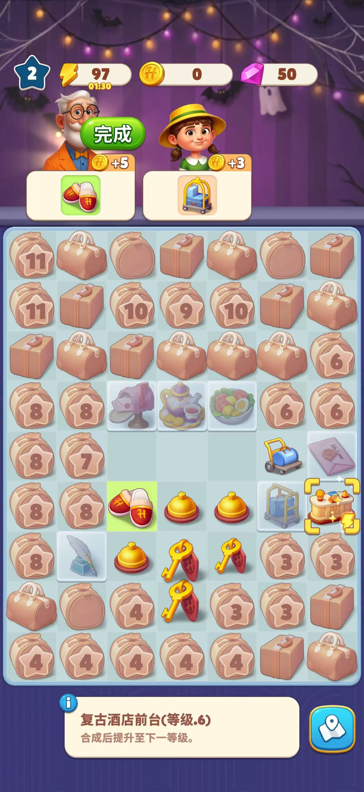
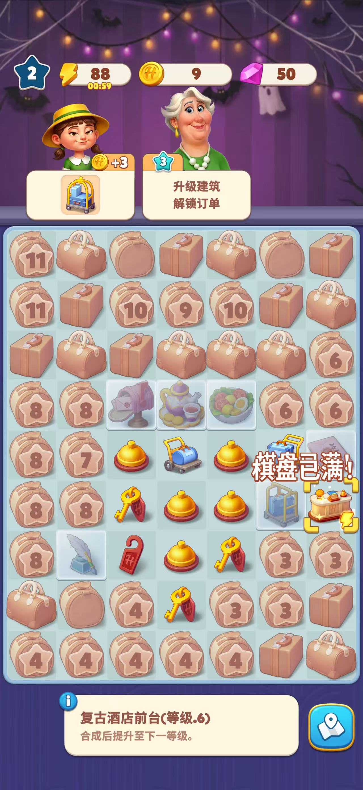
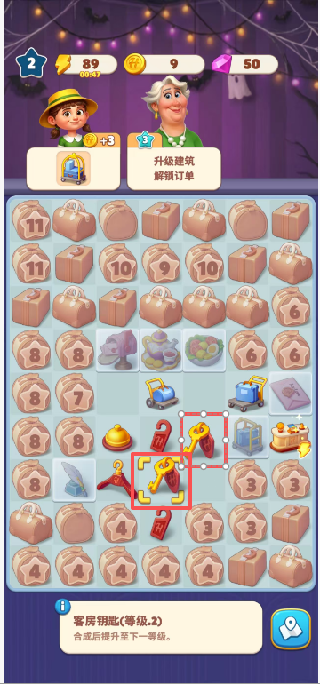
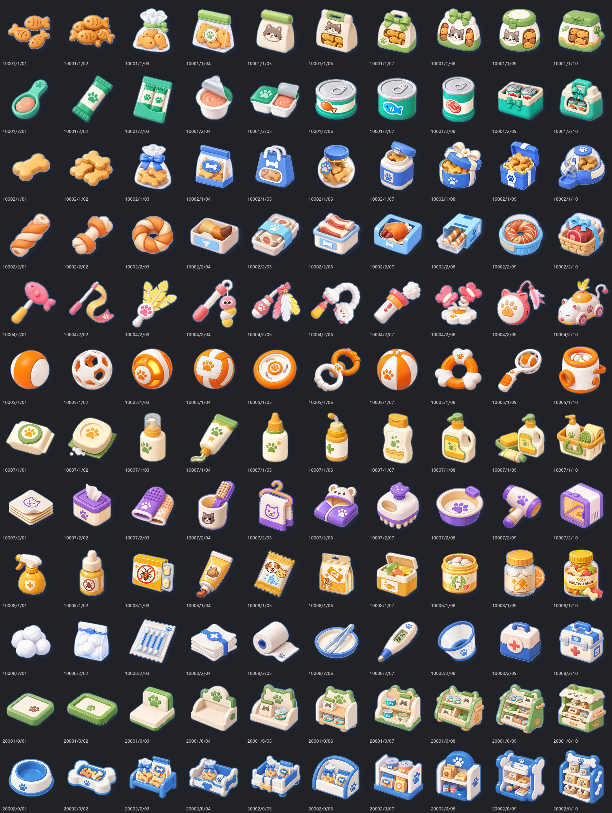
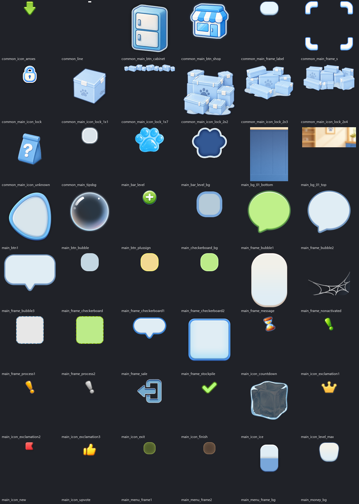
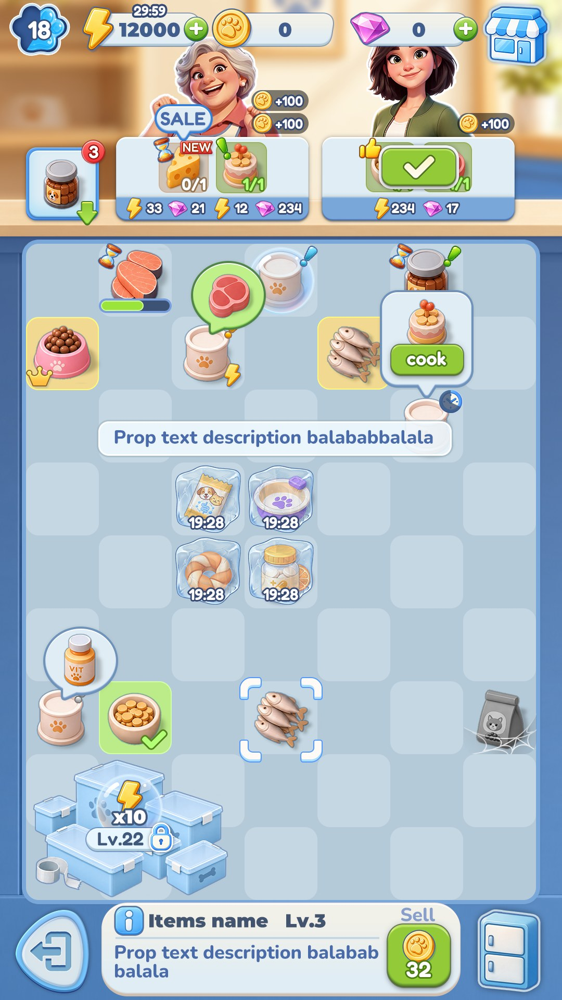
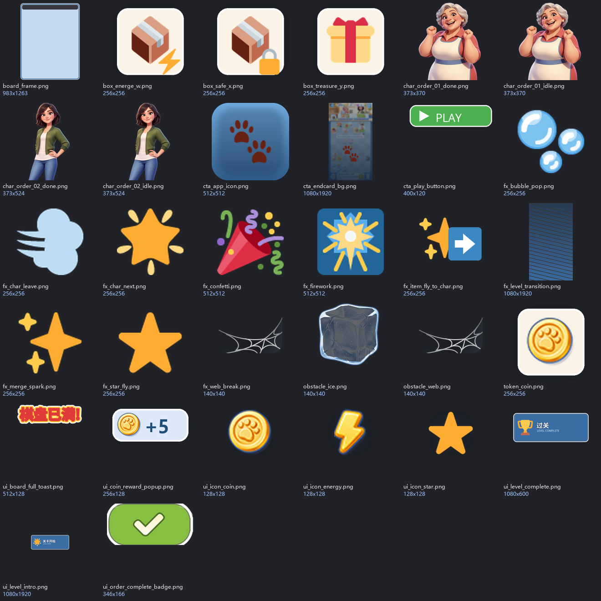

> **这是什么**：一份可以在手机上随时补充的活文档。用于把《Merge Hotel》的玩法规则，收敛成一个「视频制作人员可复用」的买量视频工具（时长可配，默认 30s）。
>
> **怎么用**：每个需求前的 `[ ]` 是待办/待确认；直接改文字、勾选、加备注即可。第 14 节是已确认/待确认；第 18 节是"玩原游戏时的观察记录"，随时追加；第 19 节是指定资源/美术。
>
> **技术结论来源**：2026-11 的 Godot 官方文档 + deep-research 对抗验证（文末有链接）。工程估算标注为"估算"，不是承诺。
>
> **M0 开工版（2026-11-03）**：以 [M0-冻结规格.md](M0-冻结规格.md) 为准；本文保留背景、资源盘点与历史讨论。资源唯一事实源：[resource_manifest.json](resource_manifest.json) / [resource_manifest.csv](resource_manifest.csv)；Excel 视图：[资源清单模板-v7.xlsx](资源清单模板-v7.xlsx)。

---

## 0. 一句话定义

做一个 **Godot 4 桌面工具**：视频制作人员通过可视化配置关卡、道具、Icon、主题，用时间轴编排事件（时长可配，默认 30s），一键离线渲染出 1080×1920@60fps 竖屏买量视频；首期只做 Godot 桌面版。

**它不是**：完整复刻《Merge Hotel》的商业游戏；不需要真实经济、广告 SDK、云存档、排行榜。

---

## 1. 产品定位

| 项 | 内容 |
|---|---|
| 用户 | 买量视频制作人员（非程序员）、美术、投放优化师 |
| 核心价值 | 把"换关卡、换道具、换 Icon、换风格、录视频"变成 10 分钟内的流水线 |
| 主要产出 | 1080×1920 / 60fps / 时长可配（默认 30s）的 MP4（首期无音轨） |
| 次要产出 | 可复用的项目文件、主题包、变体配置 |
| 成功标准 | 换主题 ≤ 10 分钟；改关卡 ≤ 5 分钟；出片 ≤ 5 分钟；非程序员可独立完成 |
| 视觉策略 | 不 1:1 还原原游戏；采用自绘/外包的 merge 风格，由主题包驱动 |
| 非目标 | 真实玩家养成、付费、广告变现、联网、账号系统、完整教程 |

---

## 2. 用户工作流（目标形态）

```
新建项目 / 选模板
   ↓
配置关卡：棋盘大小、物品摆放、生成器、订单
   ↓
配置视觉：主题包、Icon、背景、UI 皮肤、字体、音效
   ↓
编排时间轴：事件、镜头、UI 高亮、CTA（时长可配）
   ↓
预览：实时播放 / 单步调试
   ↓
出片：离线固定帧率渲染 → FFmpeg 转 MP4
   ↓
保存 / 复制变体 / 单条出片（批量后续再加）
```

理想状态下，视频制作人员 **不需要打开 Godot 编辑器**，只使用工具自己的配置界面。

---

## 3. 分镜模板（默认 30s，可伸缩）

> 下表是默认 30s 模板；时间轴长度决定成片时长，可整体缩放/裁剪（如 20s、45s、60s）。

| 时间 | 节拍 | 画面 | 工具事件 |
|---|---|---|---|
| 0–2s | Hook | 混乱棋盘 / 低阶物品堆积 / 大字 "Can you merge?" | `camera.zoom`、`text`、`highlight` |
| 2–3s | 冲突 | 网 / 泡泡 / 锁格挡住关键物品 | `camera.pan`、`highlight`、`text` |
| 3–8s | 产出 | 点生成器箱 → 物品弹出 → 顶栏资源跳动 | `tap.generator`、`spawn`、`counter` |
| 8–15s | 合并 | 三次连续合并 → 升级特效 → 分数泡 | `drag`、`merge`、`fx.levelup`、`score.popup` |
| 15–20s | 破障 | 破网/破泡/解锁 → 合并/交单 | `break.web`、`pop.bubble`、`unlock.slot`、`merge` |
| 20–24s | 交单/小人完成 | 拖入成品 → 订单卡变绿 → 点“完成” → 物品飞向小人 → 小人消失 → 金币+5 | `deliver.order`、`order.claim`、`character.leave`、`coin.popup` |
| 24–27s | 新任务/过关 | 新小人带新订单出现 → 订单全清 → "Level Complete" → 棋盘切换 | `character.next`、`level.complete`、`fx.transition` |
| 27–29s | 下一关/升级 | 新棋盘/新订单 + 等级提升/烟花 | `level.next`、`levelup`、`fx.firework` |
| 29–30s | CTA | App Icon + "Play now" + 安装按钮 | `cta`、`endcard` |

> **装修 before/after 不在首期必做**（已确认）。它保留为 P1 可选模板：如果后续素材主打"改造酒店"，再加 `renovation.reveal` 节拍；否则首期的叙事是"破障 → 合并 → 交单/小人完成 → 过关 → 升级"，更聚焦 Merge 本体。

---

## 4. 玩法最小闭环（工具版）

### 4.1 必须实现（P0）

- [ ] **棋盘**：默认 7×9，可配置宽高；格子可放物品、锁定、留空。
- [ ] **物品**：家族 + 等级 + 图标；同家族同等级两两合并 → 等级 +1。
- [ ] **生成器**：点击产出基础物品；可配产出表、次数、冷却（冷却可只做视觉）。
- [ ] **订单**：每单 1–2 件指定物品；交付后给星/金币；订单卡有未完成/完成状态。
- [ ] **订单完成交互**：订单卡完成后出现绿色“完成”标记；点击后成品飞向订单小人 → 小人播放完成动画并消失 → 金币/星星奖励 → 新小人带新订单出现。
- [ ] **生成器稀有产出**：点击生成器有低概率直接产出订单所需物品（概率可配）。
- [ ] **棋盘已满提示**：点击生成器时若无空格，弹出“棋盘已满”提示，不产出新物品（是否扣能量/次数待实机确认）。
- [ ] **顶部能量提示**：能量显示 mm:ss 倒计时，每 2 分钟跳 1 次（扣/回复方向待确认）。
- [ ] **选中与合成提示**：选中物品出现黄色框；停留/犹豫后，附近同类型同等级物品与选中物品微微放大并相互靠近，提示可合并。
- [ ] **奖励反馈**：交付后成品飞向小人 → 小人消失 → 金币/星星弹出（金币+5 为实机观察；星星飞顶栏可作为可选表现）。
- [ ] **关卡流程**：一个项目可配置 N 关；每关独立棋盘/订单/障碍；完成条件触发"过关"→ 切到下一关；关数可加/删/复制/排序。
- [ ] **障碍**：网 / 泡泡 / 锁格的显示与解除（首期必做；用于"卡住→解决"的冲突）。
- [ ] **升级/烟花**：等级提升弹窗、烟花、新物品解锁（首期必做的高潮节拍）。
- [ ] **顶栏**：等级、能量（含 mm:ss 倒计时）、金币、星星、经验条（纯视觉，可不做真实经济）。
- [ ] **CTA**：结尾卡片、按钮、文案可配。

### 4.2 可选（P1）

- [ ] 装修 before/after：星星消耗 → 家具/场景动画（如果后续视频主打"改造酒店"）。
- [ ] 多家族、多并行链（Clean / Sew / Tool / Extra / Tree）。
- [ ] 背包、出售、撤销（如果视频需要"整理棋盘"的桥段）。
- [ ] 生成器冷却/广告跳过（如果视频需要"等待→加速"的桥段）。
- [ ] 多场景装修（Facade → Lobby → Restaurant…）。
- [ ] 多语言切换 UI / 多套 CTA（文案键值表 P0，见 FR9）。

### 4.3 不实现（P2/不做）

- 真实能量经济、内购、广告 SDK、每日任务、挑战关、转盘、排行榜、云存档、反作弊、账号系统。
- 原游戏的完整数值平衡（订单曲线、通胀、难度）——广告只需要"看起来对"。

> **关键取舍**：工具是"广告视觉模拟器"，不是"游戏服务器"。把 80% 工程量花在 **可配置 + 可复现出片** 上，而不是复刻全部系统。

---

## 5. 功能需求

### FR1 项目管理（P0）

- [ ] 新建 / 打开 / 另存项目；项目 = 一个 JSON + 一个资源目录。
- [ ] 内置模板：`30s-merge-basic`、`30s-obstacle`、`15s-hook`。
- [ ] 项目复制为变体（改主题/关卡/文案后另存）。
- [ ] 项目导出/导入 zip，方便发给外包或另一台机器。

**验收**：非程序员能在 3 分钟内从模板新建一个可预览项目。

### FR2 棋盘编辑器（P0）

- [ ] 网格可视化：点击/拖拽放置物品；右键删除。
- [ ] 物品选择面板：按家族/等级/图标筛选。
- [ ] 格子属性：锁定、网、泡泡（P0）；隐藏物品（P1）。
- [ ] 生成器放置与产出表配置。
- [ ] 订单卡配置：1–2 件需求物品、星级、金币、订单小人/头像、完成动画。
- [ ] 订单角色配置：每个订单绑定一个小人/头像；完成后切换新小人/新订单。
- [ ] **关卡列表**：新建/删除/复制/排序；项目级配置"关卡数量"（默认 2，可加/减）。
- [ ] **每关独立配置**：棋盘布局、生成器、订单、障碍、完成条件、过关动画。
- [ ] **过关条件**：默认"所有订单交付"；可选"累计星/目标分数/手动事件"。
- [ ] **过关流程**：完成判定 → 过关演出 → 下一关棋盘加载（可循环/停在最后一关）。
- [ ] 一键"随机铺盘"（按权重生成一个合理棋盘）。
- [ ] 合法性校验：物品 ID 存在、等级不超上限、订单物品可获得、棋盘不越界。

**验收**：改一个 7×9 关卡 ≤ 5 分钟；能加/删/复制关卡并预览过关流程；校验能指出具体格子/字段。

### FR3 物品与生成器配置（P0）

- [ ] 物品表：`id / 显示名 / 家族 / 最大等级 / 每级图标 / 颜色`。
- [ ] 生成器表：`id / 产出物品与权重 / 稀有产出（直接出订单物品）/ 次数 / 冷却 / 广告跳过时长`。
- [ ] 支持"只换图标不改逻辑"：同一 ID 换一套图标即可复用关卡。
- [ ] 支持 CSV/JSON 导入导出（批量配置）。

**验收**：换一套 20 个物品的图标 ≤ 10 分钟，不需要改代码。

### FR4 主题 / 风格配置（P0）

- [ ] 主题包目录：`background / board_frame / chip_icons / ui_skin / font / sfx / bgm`（音频目录首期可空）。
- [ ] 主题切换：一键应用，实时预览。
- [ ] UI 皮肤：顶栏、订单卡、按钮、弹窗（可用 Godot `Theme` 资源）。
- [ ] 资源命名规范 + 缺失资源回退（占位图）。
- [ ] 主题包导出/导入（zip）。

**验收**：首期 1 套主题可完整出片；主题包结构支持后续扩展到多套。

### FR5 玩法模拟与确定性（P0）

- [ ] 纯逻辑核心：棋盘状态、合并、生成器、订单、星星。
- [ ] 固定时间步长（fixed tick），不依赖墙钟。
- [ ] 固定随机种子；同一种子 + 同一事件序列 = 同一结果。
- [ ] 障碍状态：网/泡泡/锁格的显示、解除、与合并/交单的交互。
- [ ] 订单完成状态机：missionMatched → 点击“完成” → 物品飞向小人 → 小人消失 → 奖励 → 新订单/新小人。
- [ ] 生成器稀有产出判定（权重/概率可配）。
- [ ] 生成器产出前置校验：棋盘已满 → 弹出“棋盘已满”，不产出（是否扣资源待确认）。
- [ ] 能量倒计时：顶栏显示 mm:ss；每 120 秒跳 1 次，扣/回复方向可配（实机方向待确认）。
- [ ] 选中提示：选中物品黄框；停留 N 秒后，附近同类型同等级物品与选中物品缩放+靠近动画（延迟可配）。
- [ ] 关卡状态机：进行中 → 过关 → 下一关；每关独立 BoardState/OrderState。
- [ ] 事件日志：每次点击/拖拽/合并/交付都记录为事件（可用于回放）。
- [ ] 单步执行/暂停/快进（调试广告节奏）。

**验收**：同一项目连续渲染两次，逐帧对比无差异（或肉眼无差异）。

### FR6 时间轴 / 事件编排（P0）

- [ ] 事件类型：`tap`、`drag`、`select`、`hint`、`merge`、`deliver`、`order_claim`、`character_leave`、`character_next`、`coin_popup`、`star_fly`、`board_full`、`energy_tick`、`level_complete`、`level_next`、`levelup`、`cta`、`camera`、`text`、`highlight`、`wait`；`renovation` 为 P1。
- [ ] 时间轴 UI：拖动事件、调整起止时间、复制/粘贴、批量偏移。
- [ ] 事件属性面板：目标格子/物品/订单/角色/关卡/文案/缓动/时长。
- [ ] 预置 30s 模板：Hook → 障碍 → 产出 → 合并 → 交单/小人完成 → 新小人/过关 → 下一关/升级 → CTA。
- [ ] 支持"相对时间"（例如"合并后 0.3s 播放特效"）。
- [ ] 支持可变时长：由时间轴末尾决定成片长度，默认 30s，建议 15–60s，不设硬上限。
- [ ] 支持镜头：缩放、平移、聚焦某格/某卡。
- [ ] 支持手型光标/箭头/高亮圈（广告常用引导）。

**验收**：不改代码，仅用时间轴做出一个完整故事（默认 30s，可改长度）。

### FR7 录制与导出（P0）

- [ ] **离线渲染（主路径）**：Godot Movie Maker 模式，固定 60fps，无丢帧；帧数 = 时长 × 60（30s = 1800 帧）。
- [ ] 输出：PNG 序列（首期无音轨）或 AVI；FFmpeg 转 MP4/H.264；音频后期在剪辑软件加。
- [ ] 参数：分辨率、FPS、时长、输出目录、文件名模板。
- [ ] **真人试玩录制（辅路径）**：工具内"自由模式"，外部 OBS 录屏。
- [ ] 事件录制：真人操作 → 记录事件 → 可回放/清理 → 离线出片（V1.1）。
- [ ] 批量渲染（后续 P2）：一个项目 × 多主题/多关卡/多文案 → 多个视频；当前目标不做，等有实际需求再启用。
- [ ] 渲染队列 + 失败重试 + 日志（随批量，后续 P2）。

**验收**：默认 30s / 1080×1920 / 60fps 视频 ≤ 5 分钟出片；首期手工单条；批量留作后续 P2。

### FR8 校验与交付（P1）

- [ ] 项目体检：缺图、缺字体、订单不可达、事件引用不存在、时长不足。
- [ ] 资源清单导出（JSON/CSV），方便美术对图。
- [ ] 版本号 + 变更记录。
- [ ] "一键打包"：项目 + 主题 + 输出视频 + 说明。

**验收**：外包拿到 zip 能直接打开并出片。

### FR9 文案与本地化（P0）

- [ ] 文案键值表：`text_key -> {zh, en, ...}`；默认中文，做成可配置。
- [ ] 字体按语言配置，缺字体时回退到默认字体。
- [ ] 时间轴的 `text`/`cta` 事件引用文案键，而不是硬编码字符串。
- [ ] 一键切换语言预览/出片；同一项目可导出多语言版本。
- [ ] 文案长度校验（防止超出安全区/按钮）。

**验收**：不改时间轴结构，仅换语言包即可出中/英两版。

---

## 6. 非功能需求

| 项 | 要求 |
|---|---|
| 易用性 | 非程序员 30 分钟内完成第一条视频（默认 30s） |
| 确定性 | 同一配置 + 同一种子 + 同一事件序列 → 同一画面 |
| 性能 | 默认 30s、1080×1920@60fps 出片 ≤ 5 分钟（普通 PC）；时长按比例估算 |
| 可扩展 | 新增物品/主题/事件类型不改核心代码 |
| 可移植 | 核心逻辑与渲染分离，便于维护和后续扩展 |
| 稳定性 | 渲染不因窗口失焦/掉帧中断；异常有日志 |
| 资产规范 | PNG/SVG 优先；命名约定；缺失回退 |
| 版权 | 不直接使用原游戏素材；主题包需可替换/可授权 |

---

## 7. 技术路线：Godot 4 桌面

### 7.1 为什么选 Godot

**为什么**：

1. **Movie Maker 是买量视频（默认 30s）的最优录制方式**：非实时、固定帧率、逐帧渲染，官方文档明确"perfect frame pacing; never dropped frames or stuttering"；更快的硬件只缩短渲染时间，画面一致。
2. **命令行可自动化出片**：`--write-movie`、`--fixed-fps`、`--quit-after` 在导出版项目中可用；首期单条，后续可扩展为"一个项目 × N 个变体"的批量流水线。
3. **可视化编辑器 + UI 系统**：适合做非程序员用的配置界面；Godot 的 `Resource`/`Theme`/`Inspector` 可以直接承载数据驱动配置。
4. **GDScript 对 AI 友好**：语法简单、场景文件是文本，AI 生成/修改成本低。

**限制（必须知道）**：

- Movie Maker **需要真实窗口**（可隐藏），`--headless` 不能录制；录制中不能改窗口尺寸。
- 官方明确 Movie Maker **不是给玩家实时游玩录制的**；真人试玩请用 OBS。
- 输出原生是 AVI（MJPEG）或 PNG 序列；投放平台通常要 MP4/H.264，需要 FFmpeg 转码。
- 音频 mix rate 需能被 FPS 整除，否则可能音画漂移（首期不做音频；后续加音频时注意）；必须正常退出以写全 AVI 容器。
- 历史 AVI 兼容问题来自 FFmpeg MJPEG EOI bug（2025-08 已修复），工程上优先 PNG 序列 + 新版 FFmpeg。


### 7.2 录制方案（Godot 内）

| 方案 | 适用 | 优点 | 缺点 | 建议 |
|---|---|---|---|---|
| 1. 脚本时间轴 + Movie Maker | 90% 的买量视频 | 可复现、无丢帧、可自动化（批量在 P1）、无需真人 | 需要先编排事件；不够"即兴" | ✅ 主路径 |
| 2. 真人试玩 + OBS | 探索玩法、找手感、参考素材 | 自然、真实 | 不可复现、要重录、依赖人的操作 | ✅ 辅路径 |
| 3. 真人试玩 → 记录事件 → 离线回放 | 想保留真人手感又要高质量 | 兼顾自然与可复现 | 需要事件录制/清理功能 | V1.1 推荐 |

---

## 8. 架构设计（Godot 版）

```
res://
  core/                 # 纯逻辑，不依赖 Node/场景
    board_state.gd      # 棋盘、物品、锁格
    merge_engine.gd     # 同 ID 同等级合并
    generator_engine.gd # 产出表、次数、冷却
    order_engine.gd     # 订单匹配、交付
    level_flow.gd       # 多关卡状态机：进行中 → 过关 → 下一关
    sim_clock.gd        # 固定 tick、种子
    event_log.gd        # 事件记录/回放
  game/                 # 表现层
    board_view.tscn/gd
    chip_view.tscn/gd
    generator_view.tscn/gd
    order_card.tscn/gd
    top_bar.tscn/gd
    level_transition.tscn/gd  # 过关横幅/转场
    decoration_view.tscn/gd
    cta_view.tscn/gd
    camera_rig.tscn/gd
  editor/               # 工具 UI
    project_panel.tscn/gd
    level_list.tscn/gd  # 关卡列表：加/删/复制/排序
    board_editor.tscn/gd
    item_inspector.tscn/gd
    theme_panel.tscn/gd
    timeline_editor.tscn/gd
    validation_panel.tscn/gd
  data/
    schema/project.schema.json
    templates/30s_merge_basic.json
    chips/...
    themes/default/...
  record/
    movie_recorder.gd   # 组装 CLI 参数
    export_preset.gd
  tools/
    ffmpeg_convert.ps1  # AVI/PNG → MP4
    batch_render.ps1
```

**硬规则**：

- `core/` 不引用任何 `Node`/`SceneTree`，可在无渲染环境下做单元测试。
- 所有随机数来自 `sim_clock` 的种子 RNG；禁止 `randf()` 直接用于玩法。
- 所有动画时间来自模拟时钟；禁止 `Time.get_ticks_msec()` 参与玩法判定。
- 表现层只订阅 `core` 状态，不反向修改逻辑。
- 事件日志是"广告脚本"的运行时形态，可直接保存/重放。

---

## 9. 数据 Schema（草案）

> **已被 M0 规格取代**：以下为 v1 草案，事件模型、`levels/next`、实体引用、等级上限等已在 [M0-冻结规格.md](M0-冻结规格.md) §2/§3 收敛为 v2。开工以 M0 规格为准。

### 9.1 项目文件 `project.json`

```json
{
  "version": 1,
  "meta": {
    "title": "Merge Hotel 30s - Theme A",
    "resolution": [1080, 1920],
    "fps": 60,
    "duration": 30,
    "seed": 12345,
    "locale": "zh"
  },
  "locales": {
    "zh": {"hook.question": "你能合出来吗？", "cta.play": "立即游玩", "board.full": "棋盘已满"},
    "en": {"hook.question": "Can you merge?", "cta.play": "Play now", "board.full": "Board is full"}
  },
  "hud": {
    "level": 2,
    "energy": 88,
    "energyTickSeconds": 120,
    "energyTickMode": "decrement",
    "coin": 9,
    "star": 0,
    "gem": 50,
    "exp": 0
  },
  "hint": {
    "enabled": true,
    "delay": 3.0,
    "scale": 1.08,
    "offset": 6,
    "duration": 0.25
  },
  "levelFlow": {
    "start": "level_1",
    "completion": "all_orders",
    "transition": "wipe",
    "loop": false
  },
  "levels": [
    {
      "id": "level_1",
      "name": "Level 1",
      "board": {
        "width": 7,
        "height": 9,
        "slots": [
          {"x": 2, "y": 3, "chip": "CleanSet_Ca", "level": 2},
          {"x": 3, "y": 3, "chip": "CleanBox_C", "level": 1}
        ]
      },
      "obstacles": [
        {"slot": [0, 0], "type": "lock"},
        {"slot": [1, 2], "type": "web"},
        {"slot": [2, 3], "type": "bubble"}
      ],
      "orders": [
        {
          "id": "order_1",
          "character": "char_01",
          "mission": [{"chip": "CleanSet_Ca", "level": 2}],
          "star": 1,
          "coin": 5,
          "completion": {
            "mode": "click_badge",
            "itemFlyTo": "character",
            "characterLeave": true,
            "rewardPopup": "coin"
          }
        }
      ],
      "next": "level_2"
    },
    {
      "id": "level_2",
      "name": "Level 2",
      "board": {"width": 7, "height": 9, "slots": []},
      "obstacles": [],
      "orders": [],
      "next": null
    }
  ],
  "chips": {
    "CleanSet_Ca": {
      "family": "Clean",
      "maxLevel": 11,
      "icons": {
        "1": "themes/default/chips/clean_ca_1.png",
        "2": "themes/default/chips/clean_ca_2.png"
      }
    }
  },
  "generators": {
    "CleanBox_C": {
      "charges": 10,
      "cooldown": 0,
      "outputs": [
        {"chip": "CleanSet_Ca", "weight": 60},
        {"chip": "CleanSet_Cb", "weight": 40}
      ],
      "rareOutputs": [
        {"chip": "CleanSet_Ca", "level": 2, "weight": 5, "directOrder": true}
      ]
    }
  },
  "characters": {
    "char_01": {"idle": "themes/default/chars/char_01_idle.png", "done": "themes/default/chars/char_01_done.png"},
    "char_02": {"idle": "themes/default/chars/char_02_idle.png", "done": "themes/default/chars/char_02_done.png"}
  },
  "timeline": [
    {"t": 0.0, "type": "camera", "zoom": 1.2, "focus": [3, 3]},
    {"t": 1.0, "type": "text", "text_key": "hook.question", "pos": [0.5, 0.2]},
    {"t": 3.0, "type": "tap", "target": {"slot": [3, 3]}},
    {"t": 4.0, "type": "merge", "from": [2, 3], "to": [3, 3]},
    {"t": 12.0, "type": "deliver", "order": "order_1"},
    {"t": 13.0, "type": "order_claim", "order": "order_1"},
    {"t": 14.0, "type": "character_leave", "character": "char_01"},
    {"t": 15.0, "type": "character_next", "character": "char_02"},
    {"t": 20.0, "type": "level_complete", "level": "level_1"},
    {"t": 21.0, "type": "level_next", "to": "level_2"},
    {"t": 24.0, "type": "levelup", "level": 2},
    {"t": 28.0, "type": "cta", "text_key": "cta.play"}
  ],
  "theme": "themes/default",
  "export": {"format": "png_sequence", "video": "mp4", "keep_frames": false}
}
```

> 关卡数量 = `levels` 数组长度；编辑器里的“加一关/删除/复制/排序”就是操作这个数组。每关的 `board`、`orders`、`obstacles` 独立，`next` 指向下一关（`null` 表示停在最后一关）。

### 9.2 主题包 `themes/<name>/theme.json`

```json
{
  "name": "default",
  "background": "bg.png",
  "board_frame": "board.png",
  "chip_icons": {"CleanSet_Ca": {"1": "chips/clean_ca_1.png"}},
  "ui": {
    "top_bar": "ui/topbar.png",
    "order_card": "ui/order_card.png",
    "font": "fonts/main.ttf"
  },
  "audio": {"bgm": "audio/bgm.ogg", "merge": "audio/merge.wav"}
}
```

### 9.3 事件类型（最小集）

| type | 参数 | 说明 |
|---|---|---|
| `tap` | `target: {slot}` / `{generator}` | 点击生成器/格子 |
| `drag` | `from, to, duration` | 拖拽 |
| `merge` | `from, to` | 合并两个格子的物品 |
| `deliver` | `order` | 拖入成品，订单卡变绿 |
| `order_claim` | `order` | 点击“完成”绿框，成品飞向小人 |
| `character_leave` | `character` | 小人完成动画并消失 |
| `character_next` | `character` | 新小人/新订单出现 |
| `coin_popup` | `amount, position` | 金币+5 弹出 |
| `board_full` | `text_key` | 棋盘已满提示 |
| `energy_tick` | `mode, value` | 能量倒计时跳变（扣/回复） |
| `select` | `slot` | 选中物品（黄框） |
| `hint` | `slots, delay, scale, offset` | 合成提示（同物品放大/靠近） |
| `star_fly` | `from, to, count` | 星星飞行动画 |
| `level_complete` | `level` | 关卡完成判定/过关演出 |
| `level_next` | `to` | 切换到下一关（棋盘/订单/障碍刷新） |
| `transition` | `type, duration` | 过关转场（wipe/fade） |
| `renovation` | `scene, item, effect` | 家具/场景 reveal（P1） |
| `levelup` | `level` | 升级弹窗/烟花 |
| `cta` | `text, icon` | 结尾 CTA |
| `camera` | `zoom, focus, duration, ease` | 镜头 |
| `text` | `text, pos, style, duration` | 文案 |
| `highlight` | `target, style` | 高亮/箭头/手型 |
| `wait` | `duration` | 等待 |
| `sfx` | `sound` | 音效 |

---

## 10. 录制流水线

### 10.1 主路径：脚本化离线渲染

```
project.json
   ↓ Godot --write-movie output.avi --fixed-fps 60 --quit-after 1800
AVI / PNG 序列（首期无音轨）
   ↓ FFmpeg
MP4 (H.264) 1080×1920@60（音频后期加）
```

- 帧数 = 时长 × 60fps；30s = 1800 帧；时长不设硬上限（建议 15–60s）。
- 推荐 PNG 序列 + WAV，再用 FFmpeg 合成，规避 AVI 兼容问题。
- 渲染时有真实窗口（可隐藏），不能 `--headless`；不要改变窗口尺寸。
- 批量（后续 P2）：脚本遍历 `variants/*.json`，每个变体启动一次 Godot 进程；当前目标不做。

### 10.2 辅路径：真人试玩 + OBS

- 工具提供"自由模式"：无时间轴，直接玩。
- 视频制作人员用 OBS 录屏；工具只负责画面/交互。
- 可选：记录真人操作事件 → 回放 → 离线重渲染（V1.1）。

---

## 11. 里程碑与估算

> 估算基于"1 名开发 + AI 辅助"，不含美术资产制作；单位为人日。
>
> **M0 重估**：窄路径 M0（固定模板/单主题/两关）**5–7 周**；本文原 3.5–4.5 周仅适用于“窄路径演示”，全范围按 **8–12 周**。详见 [M0-冻结规格.md](M0-冻结规格.md) §1。

| 阶段 | 内容 | 估算 | 完成标准 |
|---|---|---|---|
| M0 | 需求冻结、Schema、样例项目、素材规范 | 0.5–1 | 能用 JSON 描述一个 30s 故事 |
| M1 | 核心逻辑：棋盘/合并/生成器/订单/障碍/关卡状态机/确定性 RNG | 2.5–3.5 | 单元测试通过；同种子结果一致；可过关进下一关 |
| M2 | 棋盘/物品/订单/小人/顶栏/障碍渲染 + 过关转场 + 订单完成动画 | 3.5–4.5 | 能实时预览"破障→合并→交单→小人完成→过关→下一关" |
| M3 | 编辑器 UI：关卡列表/棋盘编辑、物品面板、订单/障碍配置、项目保存 | 2.5–3.5 | 非程序员可加关、改关、保存并预览 |
| M4 | 时间轴/事件系统 + 回放/单步 | 1.5–2.5 | 仅用时间轴做出 30s 故事 |
| M5 | Movie Maker 60fps 出片 + FFmpeg（单条） | 1.5–2.5 | 默认 30s 视频 ≤ 5 分钟出片 |
| M6 | 主题包（首期 1 套）/换 Icon/升级烟花/校验/模板/打包 | 2–3 | 换主题 ≤ 10 分钟 |
| **MVP 合计** | M0–M6 | ~~约 3.5–4.5 周~~（已作废，按 M0 重估 5–7 周） | 非程序员可独立出片 |

> 估算会因"编辑器 UI 的精细度"和"动画/特效数量"大幅波动；先做能用，再做漂亮。开发者有 20 年 Java/UE 经验 + 前端经验，M1–M3 可能比估算快；但编辑器 UI 与动画仍是主要成本。

---

## 12. 验收标准

- [ ] 首期 1 套主题可完整出片；换一套主题（背景 + 物品图标 + UI 皮肤）≤ 10 分钟，不需要改代码。
- [ ] 改一个 7×9 关卡布局 ≤ 5 分钟。
- [ ] 默认 30s / 1080×1920 / 60fps 视频 ≤ 5 分钟出片（1800 帧；以基准测试为准）。
- [ ] 时长可改（如 15s/45s/60s），时间轴与帧数自动换算。
- [ ] 同一项目连续渲染两次，画面逐帧一致（或肉眼无差异）。
- [ ] 一个项目可配置 2 关（可增删/复制/排序）；完成第 1 关订单后触发过关演出并加载第 2 关。
- [ ] 每关的棋盘/订单/障碍可独立配置，互不串数据。
- [ ] 订单完成后出现绿色“完成”标记；点击后成品飞向小人，小人消失，金币/星星奖励，新小人带新订单出现。
- [ ] 生成器有低概率直接产出订单所需物品，概率可在配置里调。
- [ ] 棋盘满时点击生成器，弹出“棋盘已满”，不产出新物品。
- [ ] 顶栏能量显示 mm:ss 倒计时；每 2 分钟跳 1 次，跳变方向可配。
- [ ] 选中物品出现黄色框；停留后附近同类型同等级物品微微放大并相互靠近。
- [ ] 时间轴可完成：Hook → 障碍 → 产出 → 合并 → 交单/小人完成 → 新小人/过关 → 下一关/升级 → CTA。
- [ ] 非程序员按文档可独立完成第一条视频。
- [ ] 项目可打包发给另一台机器/外包，打开即可用。
- [ ] 批量渲染（后续 P2）：一个项目出多个变体，待有实际需求再启用。

---

## 13. 风险清单

| 风险 | 影响 | 对策 |
|---|---|---|
| Movie Maker 需要真实窗口 | 无法在无显示 CI 出片 | 用带桌面的机器/虚拟机；不要用 `--headless` |
| 60fps 渲染耗时翻倍 | 出片时间变长 | 先用 30fps 预览，最终 60fps 出片；PNG 序列可并行/缓存 |
| 障碍动画工作量 | 破网/破泡/锁格需要额外特效 | 先做"静态遮挡 + 点击消失"的最小版本 |
| 首期不做装修 | 视频缺少"改造酒店"叙事 | 保留 P1 模板；若投放素材需要，再补 before/after 节拍 |
| AVI 兼容性 | 部分播放器/平台不识别 | 优先 PNG 序列 + 新版 FFmpeg 转 MP4 |
| 音画不同步 | 视频节奏错位 | 首期不做音频；后续加音频时，mix rate 能被 FPS 整除，用 WAV 后期合成 |
| 确定性不足 | 两次出片不一致 | 固定种子、固定 tick、事件驱动、禁墙钟 |
| 非程序员编辑器难用 | 工具落灰 | 先做 3 个真实视频任务，按任务反推 UI |
| 素材版权 | 投放合规风险 | 不直接复用原游戏素材；主题包可替换/授权 |
| 需求蔓延 | 做成完整游戏，拖慢出片 | 明确"广告视觉模拟器"边界；P2 全部砍掉 |
| 动画/特效工作量 | 出片"不够好看" | 先做 8 个节拍的模板，再逐步加特效 |

---

## 14. 需求确认（2026-11-02 已确认 + 待确认）

### ✅ 已确认

- [x] **画幅/帧率**：1080×1920 @60fps。
- [x] **时长**：不定长；时间轴决定成片长度，默认 30s，建议 15–60s，不设硬上限。
- [x] **主录制路径**：脚本时间轴为主，OBS 为辅。
- [x] **平台**：只做 Godot 桌面。
- [x] **必做节拍**：订单/小人 + 星星飞入、升级/烟花、障碍（网/泡泡/锁格）。
- [x] **装修 before/after**：首期不做，保留为 P1 可选模板。
- [x] **视觉还原度**：不 1:1 还原，像 merge 游戏即可。
- [x] **素材来源**：自绘/外包。
- [x] **音频**：先放一放；首期输出无音轨，后期在剪辑软件加。
- [x] **主题数量**：首期 1 套，结构预留多套。
- [x] **批量出片**：首期手工一条条出；批量为后续 P2。
- [x] **交付形态**：先本机，后续再定。
- [x] **开发背景**：20 年 Java、UE 蓝图、会读写 C++、会前端，懂Json；GDScript 上手成本低。
- [x] **语言**：默认中文，多套文案/字体可配置（i18n 结构）。
- [x] **使用人数**：首期 1 人。
- [x] **关卡流程**：一个项目支持多关；过关 → 下一关；关卡数量可配置（默认 2，可加/删/复制/排序）；每关独立棋盘/订单/障碍。
- [x] **订单完成与角色**：点击“完成”绿框 → 物品飞向小人 → 小人消失 → 金币奖励 → 新小人新任务。
- [x] **生成器稀有产出**：低概率直接产出订单所需物品。
- [x] **棋盘已满提示**：点击生成器时无空格 → 弹出提示，不产出。
- [x] **能量倒计时**：闪电下方显示 mm:ss；每 2 分钟跳 1 次，扣/回复方向待确认。
- [x] **选中提示**：选中物品黄框；停留后同类型同等级物品微微放大并相互靠近。

### 待确认（可直接填）

- [ ] **障碍优先级**：网/泡泡/锁格里，首条视频必须出现哪几种？
- [ ] **投放平台**：TikTok / Meta / Google / 国内？各有何规范？
- [ ] **验收人**：谁来判断"这条视频能用"？（目前还没定）

---

## 15. AI 分步实现建议

> 原则：每一步都有可验收的"最小闭环"，不要一次性让 AI 生成整个工具。

1. **冻结 Schema**：先把 `project.json` / 主题包 / 事件类型定死；用一份手写 JSON 描述一个故事（默认 30s，可改时长）。
2. **核心逻辑**：`core/` 实现棋盘、合并、生成器、订单、固定 RNG；写单元测试（无渲染）。
3. **棋盘表现**：Godot 场景渲染 7×9 棋盘、物品、拖拽、合并动画；先丑后美。
4. **订单/星星/障碍/升级**：订单卡、交付、星星飞行、破障动画、升级烟花；这是广告的爽点。
5. **编辑器 UI**：棋盘编辑、物品面板、订单配置、项目保存；先做"够用"。
6. **时间轴/回放**：事件列表 + 拖拽 + 预览 + 单步；用事件驱动整个故事。
7. **出片**：Movie Maker + FFmpeg（单条）；先出 10s 测试片，再出目标时长。
8. **主题/换皮**：主题包、Icon 替换、UI Theme、缺图回退。
9. **打包/文档**：一键打包、使用说明、模板库、验收清单。

每一步的"完成定义"都写进第 12 节验收标准，避免"看起来做完了但不能用"。

> 开发背景提示：20 年 Java/UE 经验 + 前端经验，GDScript 的学习成本很低；用 GDScript 即可，不必上 C#/C++ GDExtension。把精力放在编辑器 UI、动画和数据 Schema 上。

---

## 16. 参考来源

**Godot 官方（已对抗验证）**

- Movie Maker 教程：https://docs.godotengine.org/en/stable/tutorials/animation/creating_movies.html
- MovieWriter 类：https://docs.godotengine.org/en/stable/classes/class_moviewriter.html
- 命令行参数：https://docs.godotengine.org/en/stable/tutorials/editor/command_line_tutorial.html
- Movie Maker 发布文章：https://godotengine.org/article/movie-maker-mode-arrives-in-godot-4/
- 无窗口离屏渲染提案（仍开放）：https://github.com/godotengine/godot-proposals/issues/5790
- AVI/FFmpeg 兼容 issue：https://github.com/godotengine/godot/issues/105778

**Godot 数据驱动/工具化（已抓取）**

- Resource 数据容器：https://docs.godotengine.org/en/stable/tutorials/scripting/resources.html
- UI 换肤 Theme：https://docs.godotengine.org/en/stable/tutorials/ui/gui_skinning.html
- EditorPlugin：https://docs.godotengine.org/en/stable/tutorials/plugins/editor/making_plugins.html

**录制辅助工具**

- OBS Studio：https://obsproject.com/

**原游戏分析**

- `50_gameplay/玩法规则提炼-claude.md`
- `50_gameplay/玩法规则提炼.md`
- `50_gameplay/data/*.json`（关卡/订单/装修/商店）

> 注：以上为历史外部资料路径，未包含在本仓库。

---

## 17. 版本记录

| 版本 | 日期 | 变更 |
|---|---|---|
| v0.1 | 2026-11-02 | 初版：玩法裁剪、Godot 路线、分镜、Schema、里程碑、风险 |
| v0.7 | 2026-11-02 | 新增多关卡流程：关卡数量可配、每关独立配置、过关→下一关 |
| v0.8 | 2026-11-02 | 整理技术路线与决策记录 |
| v0.9 | 2026-11-02 | 收敛为 Godot 4 桌面单一路线 |
| v0.10 | 2026-11-02 | 回写 §18.1 的 3–5 号观察：订单完成点绿框/物品飞向小人/小人消失/金币奖励/新小人新任务；生成器低概率直接出订单物品；同步更新 P0、FR、Schema、事件、验收、资源 |
| v0.11 | 2026-11-02 | 回写 §18.1 的 6 号观察：棋盘已满时点击生成器弹提示、不产出；同步更新 P0、FR、事件、验收、资源 |
| v0.12 | 2026-11-02 | 回写 §18.1 的 7 号观察：能量倒计时（mm:ss，2 分钟一跳，方向待确认）；修正 6 号截图路径并新增 #2 索引 |
| v0.13 | 2026-11-02 | 回写 §18.1 的 8 号观察：选中黄框 + 停留后同类型同等级物品放大/靠近提示；新增 hint 配置、select/hint 事件、验收与资源 |
| v0.14 | 2026-11-02 | 盘点 HotelManor_icon（120 个棋子 icon + 48 张界面切图 + 2 个 PSD）；解析 `icon_<家族><链><等级>` 命名；生成 v3 资源 Excel（引用地址 + 缩略图）；新增 §20 棋盘搭建方案 |
| v0.15 | 2026-11-02 | 新增 v4 资源清单：用 Twemoji/Noto/PSD/PIL 补齐 31 项空白资源，放入 `剩余图标`；v3 空白行红字标注；新增 §20.9 |
| v0.16 | 2026-11-02 | 修正订单小人：从 `棋盘.psd` 只导出纯角色，去掉订单卡/金币/对号；v5 为修正版 |
| v0.17 | 2026-11-02 | 继续挖 PSD：导出金币/闪电/绿色完成药丸/冰块/蜘蛛网，替换 v4 占位；v6 为最新版 |
| v0.18 | 2026-11-03 | 按 Codex review 收敛：新增 M0-冻结规格（v2 Schema/事件模型/资源守卫/重估）；资源升级 v7/current + manifest；修复用法级别、状态、DV、标题等 |
| v0.19 | 2026-11-03 | 归档旧版资源清单（v2–v6/current/初版/旧 CSV）至 `00_design/archive/`，v7 为唯一 Excel 视图；manifest 补占位映射备注；修正 §11/§16/§18 陈旧引用；新增 .gitignore 排除 PSD 与 `.claude/` |

---

## 18. 实机观察记录（手机上玩原游戏后，随时追加）

> **用法**：你玩原游戏时，看到任何规则、数值、动画、节奏，直接按下面格式加一行。不用一次填完，也不用写得正式——我来把它翻译成需求和配置。
> 如果手机不方便编辑 MD，也可以把观察/截图发给我，我替你追加到这一节。
> **不区分关卡**：这里记录的是要实现的规则/表现，默认所有关卡通用；不用标“第几关”。

### 18.1 观察记录

| 序号 | 我做了什么 | 观察到的现象 | 推断的规则/数值 | 是否复刻 | 截图/参考图 |
|---|---|---|---|---|---|
| 1 | 点击下方格子里带闪电的小图标。 | 产出基础件；顶栏资源有变化 | 生成器点击产出 1 件；可能消耗1闪电 | P0 |  |
| 2 | 两个同级 CleanSet_Ca 拖到一起 | 合成升 1 级，播放合并特效。拖了好几次，不论是相邻还是不相邻，都可以合并。 | 同家族同等级 → +1；相邻/不相邻都可以。 | P0 | #1 |
| 3 | 记录1图片，合成出来一双小红鞋子，图片左上的小人出现完成的绿框，点击绿框，小红鞋子就飞到小人。之后是个动画，小人消失，金币+5. | 订单卡完成后出现绿色“完成”标记；点击后成品飞向小人；小人消失；金币+5 | 订单完成需要点击“完成”确认；奖励在小人消失时发放 | P0 | #1 |
| 4 | 3的任务完成后，出现新的小人，带着新的任务。 | 完成一单后，新小人带新订单出现 | 订单池循环：完成 → 新角色/新订单 → 继续 | P0 | #1 |
| 5 | 点击生成器箱，不光是出现基础件，还会随机直接出现直接完成任务的物品，不过几率比较小。 | 生成器偶尔直接产出订单所需物品 | 生成器稀有产出：低概率直接出订单物品，概率可配 | P0 | #1 |
| 6 | 棋盘满的时候，点击生成器箱，全弹Pop，显示棋盘已满 | 点击生成器时若无空格，弹出“棋盘已满”提示，不产出新物品 | 生成器产出前检查空格；无空格 → 弹提示，不产出，不扣闪电。 | P0 |  |
| 7 | 左上的闪电下面有个可爱的时间倒数，2分钟扣一个闪电。 | 闪电下方显示 mm:ss 倒计时；每 2 分钟跳 1 次 | 能量有 120 秒一跳的倒计时；扣/回复方向待确认 | P0 | #2 |
| 8 | 当选中一个物品的时候，他会带一个小黄框，当你犹豫不决的时候，他会把附近相同的物品和当前选中的物品微微的放大，并稍微相互靠近。来作为提示。 | 选中物品出现黄色框；停留后，附近同类型同等级物品与选中物品微微放大并相互靠近 | 选中提示：黄框 + 同物品缩放/靠近动画；延迟可配（推断 2–3 秒） | P0 |  |

> 序号用于行引用；截图/参考图可填相对路径（如 `images/001.jpg`），或填 `#1`/`#2`/`#3` 复用截图。截图索引：#1 = `images/001.jpg`，#2 = `images/002.jpg`，#3 = `images/003.png`。图片放进 `images/`（即 `00_design/images/`），没有图就留空。

记录提示（不用全填，想到哪写到哪）：

- 这一关的棋盘多大？哪些格子锁着？锁格怎么打开？
- 生成器点一下出什么？能点几次？冷却多久？看广告能跳过吗？
- 哪些物品能合？合成后长什么样？有没有连击/暴击？
- 订单要什么？交单后星星怎么飞？顶栏怎么变？
- 有没有网/泡泡/锁格？怎么解除？花金币还是看广告？
- 装修/升级/宝箱这些桥段，视频里要不要？几秒？
- 哪些动画/音效让你觉得"爽"？值得复刻吗？

### 18.2 关键规则确认表（确认后我来回写）

| 玩法点 | 当前默认 | 你的选择/备注 |
|---|---|---|
| 棋盘尺寸 | 7×9，可配置 | |
| 合并规则 | 同家族、同等级 → +1；拖到任意格（相邻/不相邻都可以，已实机确认） | |
| 是否允许跨家族合并 | 否 | |
| 芯片等级上限 | 订单配置最高 11，素材只到 10；M0 封顶 10 | |
| 生成器产出 | 点击产出 1 件；按权重随机；低概率直接出订单物品 | |
| 生成器次数/冷却 | 有次数与冷却；首期可只做视觉 | |
| 生成器能否合并 | 原游戏箱子有等级；工具首期不做 | |
| 生成器稀有产出 | 低概率直接产出订单所需物品，概率可配 | |
| 棋盘已满 | 点击生成器时无空格 → 弹出“棋盘已满”，不产出 | |
| 能量倒计时 | 闪电下方显示 mm:ss；每 120 秒跳 1 次（扣/回复待确认） | |
| 选中提示 | 黄框；停留后同类型同等级物品放大并靠近 | |
| 障碍类型 | 网 / 泡泡 / 锁格（三种都进 P0） | |
| 障碍解除 | 点击/广告/金币；首期做"点击消失"最小版 | |
| 订单数量 | 每条视频 1–5 单 | |
| 订单需求 | 每单 1–2 件物品 | |
| 订单奖励 | 星星 + 金币；首期星星为主 | |
| 订单完成交互 | 订单卡变绿 → 点“完成” → 物品飞向小人 → 小人消失 → 金币/星星奖励 | |
| 订单角色 | 每个订单绑定一个小人/头像；完成后切换新小人/新订单 | |
| 关卡数量 | 默认 2，可加/删/复制/排序 | |
| 过关条件 | 所有订单交付；可选累计星/手动事件 | |
| 过关演出 | "Level Complete" + 转场 + 下一关加载 | |
| 星星动画 | 从订单卡飞向顶栏 | |
| 升级触发 | 交付订单/累计星；首期也可手动事件触发 | |
| 连击/Combo | 原游戏有连续合并；工具可选 | |
| 失败/卡关 | 原游戏无传统失败；工具可选"没格子"冲突 | |
| 道具/加速 | 原游戏有广告跳过；工具可选 | |
| 手指引导 | 可选，用于 Hook |               |
|                    |                                                              | |
| 文案 | Hook/CTA 可配，默认中文 | |
| 其他玩法 | | |

### 18.3 补充玩法时的判断标准

- 它是 **30 秒视频里看得见** 的吗？看不见的数值/系统不做。
- 它能用 **一个事件 + 一个动画** 表达吗？不能就先拆小。
- 它会增加 **非程序员的配置负担** 吗？会就先做成默认值。
- 它有 **版权/合规风险** 吗？有就换成自绘/外包风格。

---

## 19. 资源 / 美术清单（Icon、UI、特效）

> 配套模板：[资源清单模板-v7.xlsx](资源清单模板-v7.xlsx)（v7 视图；含用途级别/许可/实际尺寸/适配方式；`REFERENCE_ONLY` 禁止打包）；[resource_manifest.json](resource_manifest.json) / [resource_manifest.csv](resource_manifest.csv)（程序唯一事实源）；[旧 CSV 已归档](archive/资源清单模板.csv)（过期，未同步 v7 字段）。
> 原则：**不直接使用原游戏素材**；首期只做 1 套主题、1 个家族、6 个等级，先跑通再扩。

### 19.1 命名规范

```
assets/
  chips/<family>/<chain>_lv<NN>.png      例：chips/clean/ca_lv01.png
  boxes/<family>_<box>_lv<NN>.png        例：boxes/clean_c_lv01.png
  obstacles/<type>.png                   例：obstacles/web.png
  chars/<char_id>_idle.png / <char_id>_done.png   例：chars/char_01_idle.png
  ui/<component>.png                     例：ui/topbar.png
  fx/<effect>.png                        例：fx/merge_spark.png
  bg/<scene>.png                         例：bg/main.png
  fonts/<locale>.ttf                     例：fonts/zh.ttf
  cta/<asset>.png                        例：cta/app_icon.png
```

- 全部小写、下划线分隔；等级用两位数 `lv01`。
- 芯片/箱子图标建议 **256×256 PNG（透明底）**，同家族同链保持同一视觉基线。
- UI 按 1080×1920 画布设计，按钮/卡片留 9 宫格边距。
- 特效优先用序列帧/图集，命名带帧号。
- 字体：中文/英文各一套；缺字时回退到默认字体。
- 现有素材命名：`icon_<家族5位><链1位><等级2位>.png`；主题包用映射表把设计 ID 指向实际文件（见 §20.4）。

### 19.2 首期资源范围（建议）

| 类别 | MVP 数量 | 建议尺寸 | 格式 | 优先级 |
|---|---|---|---|---|
| 芯片图标（1 家族 × 2 链 × 6 级） | 12 | 256×256 | PNG | P0 |
| 生成器箱（1 家族 × 2 级） | 2 | 256×256 | PNG | P0 |
| 特殊箱（保险/能量/宝箱/金币） | 4 | 256×256 | PNG | P1 |
| 障碍（网/泡泡/锁/冰） | 4 | 256×256 / 140×140 | PNG | P0 |
| 棋盘（背景/边框/空格/锁格） | 4 | 1080×1920 / 96×96 | PNG | P0 |
| 能量倒计时图标 | 1 | 52×52 | PNG | P0 |
| 多格锁（1×7/2×2/2×3/2×4） | 4 | 980×140 / 280×280 / 420×280 / 560×280 | PNG | P1 |
| 提示感叹号 | 1 | 52×52 | PNG | P1 |
| UI（顶栏/订单卡/按钮/图标/进度条/弹窗） | 12 | 按组件 | PNG | P0 |
| 订单角色（小人，idle/done） | 2–3 | 512×512 | PNG | P0 |
| 订单完成 UI（绿框、金币+5 弹出） | 2 | 按组件 | PNG | P0 |
| 棋盘已满提示（Toast） | 1 | 512×128 | PNG | P0 |
| 选中黄框/合成提示 | 1 | 256×256 | PNG | P0 |
| 订单完成特效（物品飞向小人/小人消失/新小人出现） | 3 | 256×256 | PNG | P0 |
| 过关/转场（Level Complete 横幅、转场遮罩） | 2 | 1080×600 / 全屏 | PNG | P0 |
| 特效（合并/星星/烟花/彩带/破泡/破网） | 6 | 256×256 图集 | PNG | P0 |
| 字体（中/英） | 2 | — | TTF/OTF | P0 |
| CTA（App Icon/Endcard/Play 按钮） | 3 | 512×512 / 1080×1920 / 400×120 | PNG | P0 |
| 音频（BGM/合并/点击/星星/升级） | 5 | — | OGG/WAV | P2（暂缓） |

### 19.3 资源卡点

- [ ] 先定 **1 个家族的视觉风格**（Clean 最直观），做出 6 级图标再决定是否扩家族。
- [ ] 订单卡最多显示 2 件物品，图标要有"小尺寸可读性"。
- [ ] 星星/金币/能量图标要能在 64×64 下辨认。
- [ ] 背景不要抢棋盘；棋盘区域保持高对比。
- [ ] 所有资源按主题包分目录，换皮时不改代码。

---

## 20. 现有资源盘点与棋盘实现

> 素材根目录：`E:\MergeGame-Claude\01_icon\HotelManor_icon`。设计清单见 [资源清单模板-v7.xlsx](资源清单模板-v7.xlsx)（K/L 列是引用地址与缩略图；M 列起是 usage/许可/实际尺寸/适配方式）。
> 实机参照图：§18.1 的 `001.jpg` / `002.jpg` / `003.png`；视觉目标：`E:\MergeGame-Claude\01_icon\HotelManor_icon\棋盘.psd`。

### 20.1 目录盘点

| 路径 | 文件数 | 说明 |
|---|---|---|
| `棋子icon\` | 120 PNG | 全部 182×182；`icon_<家族><链><等级>.png` |
| `界面切图\` | 48 PNG | `common_*` 可复用组件 + `main_*` 棋盘专用 |
| `棋盘.psd` | 1 | 1080×1920，222 层，最终棋盘效果 |
| `组件库-棋盘2.psd` | 1 | 5000×8090，354 层，组件库/设计板 |
| `剩余图标\` | 29 PNG + 2 字体 + LICENSES.md | v4 开源/占位补齐，按资源 ID 命名 |





### 20.2 棋子 icon 命名规则

规则：

```
icon_<家族5位><链1位><等级2位>.png
```

例子：

- `icon_10002101.png` = 家族 `10002` / 链 `1` / 等级 `01`
- `icon_10002106.png` = **同家族同链**第 `06` 级
- `icon_20001001.png` = 家族 `20001` / 链 `0` / 等级 `01`

家族盘点：

| 家族 | 内容 | 链 | 等级 | 数量 |
|---|---|---|---|---|
| 10001 | 猫粮 / 猫零食 | 1、2 | 01–10 | 20 |
| 10002 | 狗粮 / 狗零食 | 1、2 | 01–10 | 20 |
| 10004 | 宠物玩具 | 2 | 01–10 | 10 |
| 10005 | 球类玩具 | 1 | 01–10 | 10 |
| 10007 | 美容 / 清洁用品 | 1、2 | 01–10 | 20 |
| 10008 | 清洁 / 医疗用品 | 1、2 | 01–10 | 20 |
| 20001 | 家具系列 A | 0 | 01–10 | 10 |
| 20002 | 家具系列 B | 0 | 01–10 | 10 |
| **合计** | | | | **120** |

说明：

- 同一家族的数字后两位就是等级，**链**区分同家族的并行物品线。
- 20001/20002 的链位是 `0`，更像家具/大型物件系列，暂不当作普通棋子。
- 主题包不必改文件名：在 `theme.json` 里把设计 ID 映射到实际文件即可。

### 20.3 界面切图命名规则

- `common_*`：跨界面复用组件（锁、按钮、框、提示底）。
- `main_*`：棋盘/主界面专用（背景、格子、图标、气泡、按钮）。
- 48 张，尺寸从 `10×4` 到 `1080×1536`。

关键文件：

| 文件 | 尺寸 | 用途 |
|---|---|---|
| `main_icon_finish.png` | 52×52 | **完成对号**（订单完成绿框里的对号） |
| `common_main_frame_s.png` | 160×164 | **选中四角框**（光标/选中的棋子） |
| `main_icon_ice.png` | 140×140 | 冰冻覆盖 |
| `main_frame_nonactivated.png` | 140×140 | 蛛网/未激活覆盖（需确认） |
| `main_bg_01_bottom.png` | 1080×1536 | 背景下半 |
| `main_bg_01_top.png` | 1080×400 | 背景上半 |
| `main_money_bg.png` | 68×66 | 货币底 |
| `main_bar_level.png` / `_bg` | 98×84 / 118×104 | 等级徽章 |
| `main_frame_message.png` | 120×180 | 消息/订单框 |
| `main_frame_bubble1/2/3.png` | 144×144 / 144×144 / 188×136 | 气泡框 |
| `main_btn1.png` | 156×174 | 主按钮 |
| `common_main_btn_cabinet.png` | 144×180 | 柜子按钮 |
| `common_main_btn_shop.png` | 142×132 | 商店按钮 |
| `main_icon_countdown.png` | 52×52 | 倒计时图标 |
| `common_main_icon_lock_1x1.png` | 140×140 | 单格锁 |
| `common_main_icon_lock_1x7/2x2/2x3/2x4` | 980×140 / 280×280 / 420×280 / 560×280 | 多格锁 |
| `main_checkerboard_bg.png` | 94×94 | 格子底 |
| `main_frame_checkerboard1/2.png` | 60×60 | 格子框 |
| `main_frame_process1/2.png` | 92×92 | 进度框 |
| `main_menu_frame1/2.png` / `_bg` | 40×40 / 78×106 | 菜单框 |
| `main_icon_exclamation1/2/3.png` | 52×52 | 提示感叹号 |
| `main_frame_sale.png` / `_stockpile` | 120×78 / 156×156 | 促销/堆叠 |
| `common_icon_arroes.png` / `common_line.png` | 42×48 / 10×4 | 箭头/分割线 |
| `common_main_frame_label.png` / `_tipsbg` / `_unknown` | 64×48 / 56×56 / 140×140 | 标签/提示底/未知占位 |

### 20.4 设计 ID → 实盘文件映射

| 设计资源 | 实盘文件 | 说明 |
|---|---|---|
| `chip_clean_ca_lv01..06` | `icon_10002101..106.png` | 暂用 10002 家族链 1，即用户示例 |
| `chip_clean_cb_lv01..06` | `icon_10002201..206.png` | 10002 家族链 2 |
| `box_clean_c_lv01/02` | `icon_20001001/002.png` | 暂用家具系列占位（生成器箱待补） |
| `board_bg` | `main_bg_01_bottom.png` + `main_bg_01_top.png` | 两层叠加 |
| `slot_empty` | `main_checkerboard_bg.png` | 94×94，需放大/9 宫格 |
| `slot_locked` | `common_main_icon_lock_1x1.png` | 140×140 |
| `obstacle_web` | `剩余图标/obstacle_web.png` | PSD 常态/box1/蜘蛛网（140×80，已居中到 140×140） |
| `obstacle_bubble` | `main_btn_bubble.png` | 气泡障碍 |
| `obstacle_lock` | `common_main_icon_lock_1x1.png` | 单格锁 |
| `obstacle_ice` | `剩余图标/obstacle_ice.png` | PSD 冻结/冰块（单块，140×140） |
| `ui_select_frame` | `common_main_frame_s.png` | 选中四角框 |
| `ui_order_complete_badge` | `剩余图标/ui_order_complete_badge.png` | PSD 订单/已完成/btn（绿色药丸+对号） |
| `ui_energy_timer` | `main_icon_countdown.png` | 倒计时图标 |
| `ui_topbar` | `main_money_bg.png` + `main_bar_level.png` + `main_bar_level_bg.png` | 需组合 |
| `ui_level_badge` | `main_bar_level.png` | 98×84 |
| `ui_icon_coin` | `剩余图标/ui_icon_coin.png` | PSD icon_90000001（金币） |
| `ui_icon_energy` | `剩余图标/ui_icon_energy.png` | PSD icon_90000002（闪电） |
| `ui_icon_star` | Twemoji 占位 | PSD 没有星形图标 |
| `ui_coin_reward_popup` | `剩余图标/ui_coin_reward_popup.png` | PSD 金币 + PIL +5 |
| `ui_order_card` | `main_frame_message.png` | 120×180 |
| `ui_order_card_done` | `main_frame_message.png` + `main_icon_finish.png` | 订单框 + 对号 |
| `ui_button_primary` | `main_btn1.png` | 主按钮 |
| `ui_button_secondary` | `common_main_btn_cabinet.png` | 商店可用 `common_main_btn_shop.png` |
| `ui_popup_levelup` | `main_frame_bubble1/2/3.png` | 气泡框 |
| `ui_exp_bar` / `ui_progress_bar` | `main_frame_process1/2.png` | 进度框 |
| `ui_exclamation` | `main_icon_exclamation1/2/3.png` | 提示 |
| `ui_sale_tag` | `main_frame_sale.png` | 促销标 |
| `ui_stockpile` | `main_frame_stockpile.png` | 堆叠/库存 |
| `ui_menu_frame` | `main_menu_frame1/2.png` + `main_menu_frame_bg.png` | 菜单 |
| `ui_arrow` | `common_icon_arroes.png` | 箭头 |
| `ui_line` | `common_line.png` | 分割线 |
| `ui_tips_bg` | `common_main_tipsbg.png` | 提示底 |
| `ui_unknown` | `common_main_icon_unknown.png` | 未知占位 |
| `ui_exit` | `main_icon_exit.png` | 退出按钮 |
| `ui_new_tag` | `main_icon_new.png` | NEW 标签 |
| `ui_level_max` | `main_icon_level_max.png` | 满级 |
| `ui_upvote` | `main_icon_upvote.png` | 点赞 |

### 20.5 棋盘.psd 结构

- 画布：**1080×1920**，222 层。
- 棋盘容器 `box24`：**983×1263**，位置 `(48,466)`；7 列 × 9 行，单格约 **140.4×140.3**。
- 顶栏 `money`：等级、能量、金币、宝石等资源条。
- 订单角色：`part1`（373×370）、`part2`（373×524）。
- 底部信息条 `items`：693×183，位置 `(193,1731)`。
- 左下退出 `btn exit` 164×174；右下背包 `btn bag1` 109×147。
- 特殊格组 `棋盘特殊格子`：包含选中 `156×160`、特殊状态、角标。
- 冻结组 `冻结`：271×273，使用 `icon_10002203 / 10007208 / 10008105 / 10008109` 加冰层与 `19:28` 倒计时。
- 区域遮罩 `区域遮罩1`：413×288，包含 2×3 多格锁。
- 组件库 `组件库-棋盘2.psd`：5000×8090，354 层，分组：BG / 订单 / 物品信息总览 / 浮层 / 通用弹窗 / 常态；用于拆组件，最终画面以 `棋盘.psd` 为准。



已导出的参考切片：

- [box24.png](images/psd_slices/box24.png) — PSD 导出的棋盘容器参考（导出呈棋盘格/透明样式；蓝色容器占位见 `剩余图标/board_frame.png`）
- [money.png](images/psd_slices/money.png) — 顶栏资源组
- [part1.png](images/psd_slices/part1.png) / [part2.png](images/psd_slices/part2.png) — 订单角色
- [items.png](images/psd_slices/items.png) — 底部信息条
- [冻结.png](images/psd_slices/冻结.png) — 冰冻组
- [区域遮罩1.png](images/psd_slices/区域遮罩1.png) — 多格锁组
- [存储.png](images/psd_slices/存储.png) — 存储角标
- [棋盘特殊格子.png](images/psd_slices/棋盘特殊格子.png) — 特殊格/选中组

### 20.6 在 Godot 里搭出这个效果

目标：先做 **1080×1920 静态棋盘**，再接交互。

1. **背景**：`main_bg_01_bottom`（1080×1536）铺底，`main_bg_01_top`（1080×400）叠顶部。
2. **顶栏**：`main_money_bg` 做货币底，`main_bar_level` + `main_bar_level_bg` 做等级，`main_icon_countdown` 做能量倒计时。
3. **订单角色**：用导出的 `part1/part2`；订单卡用 `main_frame_message`，完成态叠 `main_icon_finish`。
4. **棋盘容器**：优先用 `E:\MergeGame-Claude\01_icon\HotelManor_icon\剩余图标\board_frame.png`（983×1263 蓝色容器占位），放在 `(48,466)`；`box24.png` 仅作参考。
5. **7×9 格**：单格约 140×140；格底用 `main_checkerboard_bg`（94×94）放大或 9 宫格；空格/锁定/特殊格用不同底。
6. **棋子**：`icon_<家族><链><等级>` 182×182，缩放到约 132–140，底边对齐格子，加轻微阴影。
7. **选中**：`common_main_frame_s`（160×164）套在选中格上；停留后同物品放大/靠近（§18.1 第 8 条）。
8. **完成**：`main_icon_finish`（52×52）叠在完成物品/订单上；绿色“完成”药丸底需从 PSD 补。
9. **障碍**：`common_main_icon_lock_*` 锁、`main_btn_bubble` 泡泡、`main_icon_ice` 冰冻 + `19:28` 倒计时、`main_frame_nonactivated` 蛛网。
10. **底部**：`items.png` 信息条 + `main_frame_message`/`main_btn1`/`common_main_btn_cabinet`；左下退出、右下背包。
11. **动效**：合并/星星/烟花/彩带/破泡/破网/小人出现等特效目前**没有**，先用简单 Tween/粒子占位，后续补图。

主题映射建议：

```json
{
  "chips": {
    "chip_clean_ca_lv01": "E:/MergeGame-Claude/01_icon/HotelManor_icon/棋子icon/icon_10002101.png",
    "chip_clean_ca_lv02": "E:/MergeGame-Claude/01_icon/HotelManor_icon/棋子icon/icon_10002102.png"
  },
  "ui": {
    "select_frame": "E:/MergeGame-Claude/01_icon/HotelManor_icon/界面切图/common_main_frame_s.png",
    "finish_check": "E:/MergeGame-Claude/01_icon/HotelManor_icon/界面切图/main_icon_finish.png"
  }
}
```

> 当前先用绝对路径做原型；稳定后把素材复制进 `themes/<name>/`，用相对路径，避免换机器失效。

### 20.7 缺口清单

- 棋盘绿色“完成”药丸底：v6 已从 PSD `订单/已完成/btn` 导出（含对号）。
- 完整顶栏底（只有 `main_money_bg` / `main_bar_level*` 等组件）。
- 金币/能量/星星等 900000xx 图标：v6 金币/能量已用 PSD `icon_90000001/2`；星星仍 Twemoji；宝石 `icon_90000003` 可用未纳入。
- 生成器箱图标：现有 20001/20002 是家具系列，不是箱子。
- 特效：v6 蜘蛛网/冰块已用 PSD；其余（合并/星星/烟花/彩带/破泡/小人消失/新小人）是 Twemoji/PIL 静态占位，正式版需要序列帧/粒子。
- 字体/CTA：v6 已用 Noto/Twemoji 占位；音频 5 项未补。
- `obstacle_web` 的语义已确认：PSD `常态/box1/蜘蛛网` 就是网障碍；`main_frame_nonactivated` 可保留作未激活底。

### 20.8 v3 Excel 说明

- `资源清单`：74 行设计资源；K 列引用地址、L 列缩略图；已匹配 38 条。
- `实盘资源`：168 个文件（120 icon + 48 UI），每个都有路径、缩略图、匹配资源 ID。
- `命名规则`：本节的规则摘要。
- 引用地址是当前机器绝对路径，迁移时替换根目录即可。

### 20.9 v4 开源补齐

> v7 文件：[资源清单模板-v7.xlsx](资源清单模板-v7.xlsx)；补齐资源目录：`E:\MergeGame-Claude\01_icon\HotelManor_icon\剩余图标`。程序以 [resource_manifest.json](resource_manifest.json) 为准。

- v3 中空白的 **36 行**，在 v4 主表全部用**红字**标出。
- 已补 **31 行**（29 个 PNG + 2 个字体）；剩余 **5 行是音频**（`audio_*`），未补。
- `剩余图标\` 下按资源 ID 命名，例如 `box_safe_x.png`、`ui_level_complete.png`、`fx_firework.png`、`font_zh.otf`。
- 许可证与来源见 `剩余图标\LICENSES.md`。

| 类别 | 补齐内容 | 来源/许可 |
|---|---|---|
| 特殊箱 | `box_safe_x` / `box_energe_w` / `box_treasure_y` | Twemoji + PIL（PSD 无对应箱） |
| 金币/货币图标 | `token_coin` / `ui_icon_coin` / `ui_icon_energy` | PSD `icon_90000001/2`；`ui_icon_star` 仍 Twemoji |
| 订单完成绿药丸 | `ui_order_complete_badge` | PSD `订单/已完成/btn`（绿色药丸+对号） |
| 障碍冰/网 | `obstacle_ice` / `obstacle_web` | PSD `冻结/冰块`、`常态/box1/蜘蛛网` |
| 棋盘框 | `board_frame.png` | 按 棋盘.psd 蓝色容器复刻 |
| 过关/开场/奖励/提示 | `ui_level_complete` / `ui_level_intro` / `ui_coin_reward_popup` / `ui_board_full_toast` | Twemoji + Noto + PIL（reward 用 PSD 金币） |
| 订单角色 | `char_order_01/02_idle/done` | 棋盘.psd 导出**纯角色**（无订单卡/金币）；完成态由 `main_icon_finish` 叠加 |
| 特效 | `fx_merge_spark` / `star_fly` / `firework` / `confetti` / `bubble_pop` / `web_break` / `level_transition` / `item_fly_to_char` / `char_leave` / `char_next` | `web_break` 用 PSD 蜘蛛网；其余 Twemoji / PIL 静态占位 |
| 字体 | `font_zh.otf` / `font_en.ttf` | Noto Sans OFL 1.1 |
| CTA | `cta_app_icon` / `cta_endcard_bg` / `cta_play_button` | Twemoji + Noto + PIL |
| 音频 | `audio_*` 5 项 | 未补（非图标） |

> PSD 还能导出、但当前设计清单没建行的：`icon_90000003`（宝石）、`棋盘特殊格子/角标/满级`（48×36 皇冠）、`money/1`/`money/2`（顶栏计数器）、`common_main_icon_tick`（白色对号）、`常态/box1/选中`（选中文本）。需要时按资源 ID 补行即可。



**风格说明**：Twemoji 是扁平 emoji 风格，和项目现有 3D 卡通宠物店风格仍有差距；v4 只保证“有图可用、ID 对齐、可替换”，不保证最终美术品质。正式投放前建议把红字行替换为自绘/外包资源。

**是否补齐**：图标、UI、特效、字体、CTA 的占位基本补齐（31/36）；音频 5 项没补，角色表情/特效序列帧也需要后续精修。所以是“可跑通原型的补齐”，不是“最终美术齐套”。

